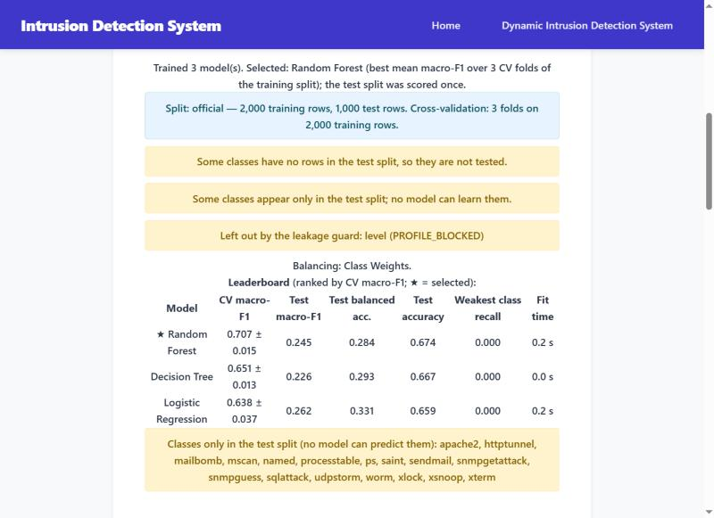
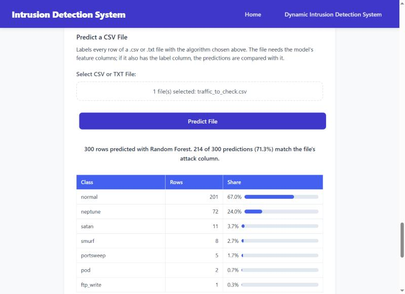

# 🛡️ Network Security Toolkit

A local-first network security toolkit with optional external intelligence services: a **port scanner** with CVE lookups, and an **IDS model trainer and predictor** for flow datasets (CIC-IDS2017, NSL-KDD or your own CSV). It is not a live network IDS: it doesn't capture or watch traffic (PCAP files and live capture are stretch items, not built).


---

## ⚠️ Project status — read first

**v5.3 ("impressive features", the first part: Saved Runs, the explanations and the review's hardening)** is released (tag `5.3`), after **v5.2 ("the user's improvements")** (tag `5.2`), **v5.1 ("clean architecture")** (tag `5.1`) and **v5.0 ("correct & safe")** (tags `5.0` and `5.0.1`). One condition of the outside review is still open: real use by someone who is not the developer, and Linux and macOS (see below). See [docs/IMPROVEMENT_PLAN.md](docs/IMPROVEMENT_PLAN.md), the day-to-day [docs/V5.3_CHECKLIST.md](docs/V5.3_CHECKLIST.md) (and [docs/V5.2_CHECKLIST.md](docs/V5.2_CHECKLIST.md), [docs/V5.1_CHECKLIST.md](docs/V5.1_CHECKLIST.md) and [docs/V5.0_CHECKLIST.md](docs/V5.0_CHECKLIST.md) for the earlier versions), and what changed in each version in the [CHANGELOG](CHANGELOG.md). A measured baseline of the original version, v4 ([docs/baseline/FINDINGS.md](docs/baseline/FINDINGS.md)), showed that **earlier accuracy claims were not valid**:

- **IDS CLI model (v4):** it uses `Attempted Category`, a feature derived from the attack label itself. Changing only that value flips the prediction (e.g. `-1` turns every sample into BENIGN), and none of the CLI's 4 built-in sample flows is classified as intended. **The previously stated ~97–98 % accuracy is withdrawn.** Its files were deleted in v5.0 step 0.5: the CLI now uses the models you train and export in the fixed web trainer, and shows each one's real metrics from its training record (see the CLI's [model card](docs/ids_cli_models.md)).
- **Web IDS trainer (v4):** its results were **optimistic**. "Apply SMOTE" and "Recommend Features" ran on the *whole* dataset before the train/test split, duplicate rows could land in both train and test, and label-derived columns (e.g. NSL-KDD `level`) were not blocked. The recommender even ranked `level` among the top 10 features. The app reported accuracy and weighted F1 only, which hide weak minority classes: on NSL-KDD, random forest showed 99.8 % accuracy but 76.6 % macro-F1. **Since 5.0-rc1 (step 0.4g) the web trainer runs on the leakage-free ML core** described under "ML core" below. The same datasets and scenarios re-run on that core, before vs after, are in the **ML report**: [docs/report/FINDINGS.md](docs/report/FINDINGS.md).

### Known limitations (current version)
- Web trainer scores on CIC-IDS2017 come from a stratified (random) split, because the file has no time column: flows of the same attack can be on both sides, so the scores may still be optimistic (the app says so). NSL-KDD uses its official test file.
- No claim of generalization: the scores on CIC-IDS2017 and NSL-KDD show a model on rows like its training rows only. No model has been tested on traffic from another network, another flow tool or another time.
- What a model relies on, and **Why?** under a prediction, are a diagnosis of one run and an approximation, not causes: features that go together share their effect, a row with one value swapped may never occur in real traffic, and the probabilities are not calibrated ([user guide 4.5 and 4.6](docs/user_guide.md#45-step-5-train)).
- Exported models are signed **`.bundle`** files that load only on the toolkit install that made them. The signing key is created in `instance/signing.key` on the first export: back up the key, `instance/bundles/` and `instance/runs/` ([user guide, section 6.2](docs/user_guide.md#62-back-up-and-restore)). Each tool limits `instance/` and `.env` to your account when it starts (on Windows: your account, SYSTEM and Administrators only, nothing inherited). If the key is lost, the bundles can't be loaded any more; retrain from the run's record in `instance/runs/`. Loading bundles from another computer is not part of v5.3.
- Training runs as a background job with a progress bar and a **Cancel training** button. The server trains one job at a time; others wait in a queue. Cancel takes effect after the model being fitted at that moment, so on the full CIC file it can take a while; a job is also stopped after 180 minutes (`TOOLKIT_JOB_MAX_MIN`). A cancelled or failed job keeps nothing. On the full CIC file training takes many minutes and about 6 GB of memory.
- Web trainer data lives in memory, one workspace per browser session (tabs of the same browser share it). It is lost when the app restarts (a training or a scan it cut off is told at the next start, in the terminal and once on its page, as `INTERRUPTED`), removed after 240 minutes without use (`TOOLKIT_WORKSPACE_IDLE_MIN`), or with the **Clear workspace** button. Only one training runs at a time per workspace, and the dataset can't be changed while it runs. At most 4 workspaces (`TOOLKIT_MAX_WORKSPACES`) and 4,096 MB of loaded datasets (`TOOLKIT_MAX_DATA_MB`; trained models not counted) are kept: the least recently used other session's workspace makes room first. The upload message reports how much memory the dataset takes. If you serve the app over HTTPS, set `TOOLKIT_HTTPS=1` so the session cookie is marked `Secure`. The page sends a per-session security token with every change (CSRF protection); after the app restarts, reload the page before going on.
- Port scanner, what leaves your computer: CVE lookups send the detected software name and version (for example `OpenSSH 8.9`) to the public NVD API. The AI explanation (OpenRouter) gets the same software name only, never the raw banner, and the AbuseIPDB check a public target address only. All three are on by default; the AI and AbuseIPDB need their key in `.env` (putting it there is the choice to use them), and each can be turned off for a scan (`--no-nvd`, `--no-ai`, `--no-abuseipdb`, or no to its question). A service that fails during a scan is not asked again in that scan: the summary names it and why, and its ports say `NOT CHECKED`. Every scan says first what it may send to each service, or why it sends nothing (no key, turned off, a private address), and at the end how many requests went to each.
- CVEs come from NVD. For about 20 products (OpenSSH, Apache, nginx, IIS, MySQL, MariaDB, Redis, ...) they are matched **by version** (the CVEs whose affected versions, as NVD records them, include it); any other product, or one the version match found nothing for, gets a **keyword search** on its name and version, which can include CVEs that don't affect the exact build, or miss some. Each CVE says which: **version match**, or **name match, unconfirmed** (the version was not checked); when no version match has the worst score, the severity says so too (`CRITICAL (unconfirmed)`). Severity comes from the CVSS scores only. Lookups run up to 4 at a time with a 15 s timeout each, and each product is looked up once per scan (a failed lookup is tried again on the next host). Without an NVD key, NVD allows about one request every 6 seconds and that spacing is kept, so CVE lookups for many different products stay slow; with a key (`NVD_API_KEY`) the limit is one every 0.6 s, and the AI explanations always run in parallel.
- The OS guess weighs the ping TTL, words in the banners and open ports only one OS has, and lists each with where it was seen; it is still only a guess (Windows, a Linux distribution, BSD, network device). It says when they disagree (the ping may be answered by NAT or a forwarded port) and when the target is this computer (whose ports may lead to a VM, a container or WSL). Hosts that don't answer ping, and IPv6 targets on Windows (no TTL shown), are guessed from their banners only. On Windows, closed and firewalled TCP ports look the same, so both are reported as closed. A UDP port that doesn't answer is reported as `open|filtered`.
- Scans are limited to 256 hosts and 65,536 host×port checks (`TOOLKIT_SCAN_MAX_HOSTS`, `TOOLKIT_SCAN_MAX_PROBES`), and each one asks you to confirm you are authorised (`--i-am-authorized` in scripts).
- No model is shipped with the project: train and export one in the web trainer first. The CLI lists the exports in `instance/bundles` (a bundle that is only part of its file as `INCOMPLETE`, never removed on its own) and opens only bundles exported on this install. Large models (for example Random Forest on the full CIC file, about 2 GB) take minutes to load and need several times their size in memory. A bundle made with a different scikit-learn, imbalanced-learn, XGBoost or LightGBM minor version is refused (retrain it); smaller version differences are shown as a warning.
- The web trainer opens in your default browser once it is ready and prints its address (`http://127.0.0.1:5000/`; `--no-browser` or `TOOLKIT_NO_BROWSER=1` to not open it); stop it with Ctrl+C (from the launcher menu, that brings the menu back).
- Tested on Windows 10 with Python 3.14: automated tests at three levels (unit, integration and end-to-end; what each covers, and the manual checks with their dates, are in [docs/architecture.md §12](docs/architecture.md#12-test-levels-and-manual-checks)), a fresh install followed by a scripted walk-through of every menu path (`scripts/menu_walkthrough.py`), and browser sessions through the whole web trainer on real CIC-IDS2017 and NSL-KDD data and through the port scanner (`docs/release/`); an install on Python 3.11 was checked at 5.1. The number of tests is not a measure of readiness. **Linux and macOS: the code is written to be portable, but it is not tested on real machines:** the OS-specific code (ping options, paths, file encodings) is unit-tested with a patched platform only.
- Only scan systems you are authorised to scan.

---

## 📋 Table of Contents

- [Features](#-features)
- [Installation](#-installation)
- [Usage](#-usage)
- [Documentation](#-documentation)
- [Web IDS Features](#-web-ids-features-detailed)
- [Project Structure](#-project-structure)
- [Machine Learning Models](#-machine-learning-models)
- [API Keys Setup](#-api-keys-setup)
- [Screenshots](#-screenshots)
- [Contributing](#-contributing)
- [License](#-license)

---

## 🎯 Features

### 1. Network Reconnaissance (Port Scanner)
- 🔍 TCP/UDP port scanning, with the toolkit's own scanner or, if it is installed and you ask for it, nmap (`--engine nmap`: service detection, OS detection, 8 allowed scripts)
- 🖥️ OS guess from the TTL, the banners and the open ports, with the evidence
- 🏷️ Service banner grabbing
- 🌐 IPv4, IPv6, networks (CIDR) and domain names
- 🔐 CVE lookup via the NVD CVE API 2.0, with CVSS scores; severity comes from CVSS only
- 🤖 Optional AI explanation (OpenRouter), only after you agree; it receives the software name and version only, and its reply is shown as plain text marked "may be wrong"
- 📊 IP reputation check (via AbuseIPDB), only after you agree
- 🖱️ The same scanner from the web app's **Port Scanner** page (`/scan`): a form, a live log, Cancel, a card per open port and the report as TXT, JSON or CSV ([user guide 3.6](docs/user_guide.md#36-scan-from-the-web-page)); from another computer with `toolkit web --host`, behind an access token ([3.7](docs/user_guide.md#37-scan-from-another-computer))
- 📁 Export results to JSON/CSV/TXT (UTF-8, in `instance/scans/`, never overwritten, safe to open in a spreadsheet)

### 2. IDS predictor (CLI)
- 🧠 Predicts with any model bundle exported by the web trainer (features, classes and best model come from the bundle)
- 📊 Uses the models you export from the web trainer: it lists them (newest first) and you pick one; each shows its real metrics from its training record
- ⌨️ Manual input (prefilled from a real example), real test-split examples, model switching
- 📄 `--csv` batch prediction (writes `<file>.predictions.csv`, never overwritten; the web trainer's "Predict a CSV file" gives the same file), `--json` input, `--info` model card
- 🗂️ `--runs` lists the saved runs and `--compare A B` puts two side by side, without loading a model ([user guide 5](docs/user_guide.md#5-use-your-model-in-the-terminal))

### 3. IDS model trainer (Web) ⭐ NEW FEATURES
- 🌐 Web-based UI with Flask
- 🧭 **Step by step** - Data → Explore → Clean → Features → Train → Use, one step at a time (a loaded bundle: Data → Use); after a reload the page shows the session's dataset, results, a running training and the export link again
- 📤 Upload custom datasets (CSV/TXT)
- 📊 **Data Preview** - View first N rows with statistics
- 🎛️ **Dynamic model training** - Train on any dataset
- 📈 **Smart Data Analysis** - Automatic imbalance detection
- 🤖 **Intelligent Recommendations** - Best balancing method suggestion
- 🎚️ **8 Balancing Methods** - SMOTE, ADASYN, SMOTE-ENN, etc.
- 🎯 **Target Value Filtering** - Remove unwanted classes
- 📉 **Confusion Matrix** - Visual model evaluation
- 📊 **Charts of a run** - CV fold by fold, CV against test, recall per class, fit time
- 🗂️ **Saved Runs** - every training listed, exported or not; one shown, or two compared (a difference only when both scored the same test rows) ([user guide 4.8](docs/user_guide.md#48-compare-saved-runs))
- 🔀 **Train/Test Split Slider** - Customize data splits
- 💾 **Export / Load Models** - signed `.bundle` files (all models of a run plus its training record)
- 📄 **Predict a CSV file** - label every row of a file with the session's model or a loaded bundle: rows per class with bars, how many match the file's label column, and the labelled CSV to download (the same file as the CLI's `--csv`; files up to 512 MB, `TOOLKIT_MAX_PREDICT_MB`)

---

## 🚀 Installation

### Prerequisites
- Python 3.11 or newer (developed and tested with Python 3.14 on Windows)
- pip

### Steps
Everything runs locally; no account or online service is needed for the IDS.

```bash
# 1. Open a terminal in the project folder (the folder that contains main.py)

# 2. Create a virtual environment in .venv
python -m venv .venv

# 3. Activate it
#    Windows (PowerShell):  .venv\Scripts\Activate.ps1
#    Windows (cmd):         .venv\Scripts\activate.bat
#    Linux / macOS:         source .venv/bin/activate

# 4. Upgrade pip (a new venv starts with the pip its Python came with)
python -m pip install --upgrade pip
#    Python 3.11 also puts an old setuptools (65.5.0, with known advisories) in a new venv:
#    python -m pip install --upgrade pip setuptools

# 5. Install the pinned dependencies
python -m pip install -r requirements.txt
```

If PowerShell refuses `Activate.ps1` ("running scripts is disabled on this system", the Windows default), activate in cmd with `.venv\Scripts\activate.bat`, or allow local scripts for your user once: `Set-ExecutionPolicy -Scope CurrentUser RemoteSigned`.

Or install the toolkit as a package, which also gives you the `toolkit` command (`toolkit scan`, `toolkit ids`, `toolkit web`). An installed copy keeps its data in a per-user folder ([docs/reference.md](docs/reference.md#73-where-the-data-folder-is)):

```bash
python -m pip install ".[boost]"
```

### Dependencies
Versions are **pinned** so results are reproducible and the bundled models load:
- `requirements.txt`: runtime libraries (Flask, waitress, pandas, numpy, scikit-learn, imbalanced-learn, XGBoost, LightGBM, requests)
- `requirements-dev.txt`: adds the development tools (pytest, ruff, mypy, pip-audit)
- `requirements.lock`: the complete environment, for an exact rebuild (`python -m pip install -r requirements.lock`)

### Datasets
Datasets are **not** part of the repository. Put them in `data/raw/`; see [docs/datasets.md](docs/datasets.md) for the expected files, their SHA-256 fingerprints and known data-quality issues.

### Development & tests
```bash
python -m pip install -r requirements-dev.txt
python -m pytest              # run the test suite
python -m ruff check .        # lint
python -m mypy                # strict type check of the whole toolkit package
python -m pip_audit -r requirements.lock   # check dependencies for known vulnerabilities
git config core.hooksPath .githooks         # once per clone: lint, types + tests before every commit
```

---

## 📖 Usage

### Main Menu
```bash
# From the project folder (python main.py does the same)
python -m toolkit
```

This launches an interactive menu with options:
1. **Network Reconnaissance** - Port scanning and vulnerability detection
2. **Intrusion Detection (CLI)** - Command-line ML-based IDS
3. **Intrusion Detection (Web)** - Web-based IDS trainer
4. **Exit** (or `q`)

Each tool runs on its own and the menu comes back when it ends (Ctrl+C stops a tool).
Every tool can also be started directly with a command:

| Command | Tool |
|---|---|
| `python -m toolkit scan` | Network reconnaissance |
| `python -m toolkit ids` | IDS CLI |
| `python -m toolkit web` | IDS web interface and the Port Scanner page |

`python -m toolkit --help` lists them and `python -m toolkit <command> --help` shows a tool's options.

### Network Reconnaissance
```bash
# Interactive: asks for the target, ports, protocol and the rest (from the project folder)
python -m toolkit scan
# With a target: asks nothing but "are you authorised?"
python -m toolkit scan 192.168.1.10 -p 1-1024 --protocol both --export csv
# Scripts: not even that (you confirm you are authorised to scan the target)
python -m toolkit scan 192.168.1.10 -p 22,80,443 --i-am-authorized
```

Features:
- Enter target IP (IPv4 or IPv6), network (CIDR) or domain
- Specify port range (1-65535)
- Choose TCP/UDP/both protocols
- Confirm you are authorised to scan the target (or pass `--i-am-authorized`)
- View vulnerability reports
- Export results
- Ctrl+C cancels a scan ("Scan cancelled.", exit code 130)

With a target, every choice is a flag (`python -m toolkit scan --help`), and nothing but the CVE lookups leaves your computer unless a flag says so:

| Flag | Default |
|---|---|
| `-p`, `--ports` `80`, `1-1024` or `22,80,8000-8100` | `1-1024` |
| `--protocol tcp\|udp\|both` | `tcp` |
| `-v`, `--verbose` (progress while scanning) | off |
| `--no-nvd` (no CVE lookups: the software name and version to NVD) | NVD on |
| `--no-ai` (no software names to OpenRouter; on needs `OPENROUTER_API_KEY`) | on with the key |
| `--no-abuseipdb` (no public target IPs to AbuseIPDB; on needs `ABUSEIPDB_API_KEY`) | on with the key |
| `--scan-unresponsive` (hosts that don't answer ping) | skipped |
| `--export txt\|json\|csv` (to `instance/scans/`, never overwrites) | no export |
| `--i-am-authorized` | asks |

### IDS CLI
```bash
# Interactive: lists your exports from the web trainer, you pick one
python -m toolkit ids
# Label every row of a CSV file (with the newest export)
python -m toolkit ids --csv flows.csv
# A specific export
python -m toolkit ids --bundle "instance/bundles/<run id>.bundle"
```

Train and export a model in the web trainer first; `--list` shows your exports and `--info` the chosen model's card.

### IDS Web Interface
```bash
# Run the web server (from the project folder); the page opens in your default browser
python -m toolkit web
# Another port, without opening the browser
python -m toolkit web --port 5001 --no-browser
```

The page is `http://127.0.0.1:5000/` (the address is always printed), the port scanner
`http://127.0.0.1:5000/scan`; Ctrl+C stops the server.
If the port is already in use (for example, the trainer is already running), it says so and
stops: start it on another port with `--port`. One trainer runs per data folder: a second one
on the same `instance/` says which one holds it and stops. `TOOLKIT_NO_BROWSER=1` never opens the browser.

---

## 📚 Documentation

| Document | What's in it |
|---|---|
| [User guide](docs/user_guide.md) | Every tool step by step, with screenshots of the web trainer |
| [Reference](docs/reference.md) | Every command, flag, exit code and `TOOLKIT_*` setting; the data folder on each OS |
| [Web API](docs/web_api.md) | The web trainer's `/api/v1` routes, its security token and error codes |
| [Architecture](docs/architecture.md) | The layers, a map of every module and the main flows, with text diagrams |
| [Model card](docs/model_card.md) | What the IDS models are for, their training data, measured results and limits |
| [Datasets](docs/datasets.md) | The expected files, their fingerprints, licences and citations |
| [ML report](docs/report/FINDINGS.md) | v4 against the fixed ML core, measured on the same data |
| [CHANGELOG](CHANGELOG.md) | What changed in each version, and how to upgrade |
| [LICENSE](LICENSE) | The MIT licence of the code |

---

## 🌐 Web IDS Features (Detailed)

### 📊 Data Preview
After uploading a dataset, view:
- First N rows of data (configurable)
- Total rows & columns count
- Numeric vs Categorical columns
- Interactive table view

### 📈 Smart Data Analysis
The system analyzes your dataset; the recommendation below uses the **training split only**:

| Metric | Description |
|--------|-------------|
| **Imbalance Ratio** | Minority/Majority class ratio |
| **Severity** | mild (>50%), moderate (10-50%), severe (1-10%), extreme (<1%) |
| **Dataset Size** | small (<1K), medium (1K-10K), large (10K-100K), very_large (>100K) |
| **Dimensionality** | low (<20), medium (20-100), high (>100 features) |
| **Classes** | Binary (2) or Multi-class (>2) |

### 🤖 Intelligent Recommendations
Based on your data characteristics, the system recommends the best balancing method:

| Data Characteristics | Recommendation |
|---------------------|----------------|
| Balanced (>50% ratio) | None |
| Small dataset (<1000 samples) | Class Weights |
| Many classes (>10) + Extreme imbalance | Class Weights |
| Multi-class + Very Large + Severe | SMOTE-ENN |
| High dimensionality (>100 features) | Class Weights |
| Minority class < 6 samples | Class Weights (SMOTE needs ≥6) |

### 🎚️ 8 Balancing Methods

| Method | Description | Best For |
|--------|-------------|----------|
| **None** | No balancing | Balanced datasets |
| **Class Weights** ⭐ | Adjusts model weights | Fast, safe choice |
| **SMOTE** | Synthetic oversampling | Medium datasets |
| **SMOTE-ENN** | SMOTE + noise removal | Large datasets |
| **ADASYN** | Adaptive synthetic sampling | Complex boundaries |
| **Borderline-SMOTE** | Focus on boundaries | Overlapping classes |
| **Random Undersampling** | Remove majority samples | Very large datasets |
| **Tomek Links** | Clean boundaries | Noisy data |
| **SMOTE + Tomek** | Combined approach | Balanced solution |

### 🎯 Target Value Filtering
Remove specific classes before training:
- View all class/label values with counts
- Select values to remove (e.g., "BENIGN" to focus on attacks)
- Dataset updates automatically

### 📉 Confusion Matrix
Visual evaluation of model performance:
- Select a trained model
- Shown for the test split (models are compared by cross-validation on the training rows; there is no separate validation split any more)
- View matrix with color-coded cells
- See True Positives, False Positives, etc.

### 🔀 Train/Test Split Slider
Customize data splits:
- In the Explore step, next to the target column: the class analysis, balancing preview, feature scores and training all use this split
- Slider range: 10% to 50% for the test split (default 20% → Train: 80% | Test: 20%)
- Datasets with an official test file (NSL-KDD) use that file instead
- Real-time label update

---

## 📁 Project Structure

```
Project/
├── main.py                          # Same as python -m toolkit
├── requirements.txt                 # Pinned runtime dependencies
├── requirements-dev.txt             # + pytest, ruff, mypy, pip-audit
├── requirements.lock                # Exact environment
├── pyproject.toml                   # Packaging, pytest / ruff / mypy configuration
├── .gitignore                       # Git ignore rules
├── .env.example                     # Optional API keys template (copy to .env)
├── .githooks/pre-commit             # Lint, types + tests before every commit
├── README.md                        # This file
├── CHANGELOG.md                     # What changed in each version
├── LICENSE                          # MIT
│
├── data/raw/                        # Local datasets (gitignored, see docs/datasets.md)
├── docs/                            # Improvement plan, checklists, datasets, web API, baseline, ML report
├── scripts/baseline_v4.py           # Reproduces the "before" baseline (docs/baseline/)
├── scripts/ml_report.py             # Re-runs it on the v5 ML core (docs/report/)
├── tests/                           # pytest suite + small fixtures
│
├── toolkit/                         # The package, in four layers with a folder per tool (docs/architecture.md)
│   ├── __main__.py                  # python -m toolkit (the menu, or scan / ids / web)
│   ├── ui/                          # What the user sees; the only code that prints or asks
│   │   ├── web/                     #   the web trainer's page: templates/, static/ (css/, js/ ES modules)
│   │   └── cli/                     #   the menu, the scanner's and the IDS's prompts and printing
│   ├── controllers/                 # Requests and flags in, answers and exit codes out
│   │   ├── web/                     #   the Flask app, its routes, run_server (waitress on 127.0.0.1)
│   │   └── cli/                     #   the toolkit command: main (menu), scan, ids, web
│   ├── services/                    # What the tools do: no user interface, no files, no network
│   │   ├── ids/                     #   the leakage-free ML core (see "ML core" below), bundles, predictions
│   │   ├── recon/                   #   targets and limits, the scan, the lookups, report entries
│   │   └── web/                     #   workspaces, the training job runner, the work behind the routes
│   └── data/                        # Files, the network, the environment (no database)
│       ├── settings.py, keys.py     #   TOOLKIT_* settings, the data folder, API keys from .env
│       ├── logs.py                  #   log files in instance/logs, secrets redacted
│       ├── ids/                     #   bundle and run files, dataset files
│       ├── recon/                   #   sockets, ping, banners, NVD / OpenRouter / AbuseIPDB, scan reports
│       └── web/                     #   uploads (read, then deleted), the listening socket, the browser
│
└── docs/ids_cli_models.md           # Where the CLI's models come from (your exports)
```

---

## 🤖 Machine Learning Models

### Datasets
- **Used and profiled:** CIC-IDS2017 (original "MachineLearningCSV" variant and a filtered DDoS subset) and NSL-KDD. Details, SHA-256 fingerprints and data-quality issues are in [docs/datasets.md](docs/datasets.md).
- **Not tested yet:** CIC-IDS2018, UNSW-NB15 and other CSV/TXT files. They can be uploaded to the web trainer, but they haven't been verified.

### Algorithms
| Algorithm | Type | Strengths |
|-----------|------|-----------|
| **Random Forest** | Ensemble | High accuracy, robust, handles imbalanced data |
| **Logistic Regression** | Linear | Fast, interpretable, good baseline |
| **K-Nearest Neighbors** | Instance-based | Simple, no training phase |
| **Support Vector Machine** | Kernel-based | Effective in high-dimensional spaces |
| **Decision Tree** | Tree-based | Interpretable, fast inference |
| **Naive Bayes** | Probabilistic | Fast, handles large datasets |
| **Gradient Boosting** | Ensemble | High accuracy, sequential learning |
| **AdaBoost** | Ensemble | Combines weak learners effectively |
| **Extra Trees** | Ensemble | Fast, randomized splits |
| **XGBoost** *(optional)* | Boosting | State-of-the-art performance |
| **LightGBM** *(optional)* | Boosting | Fast training, memory efficient |

> **Note:** XGBoost and LightGBM are included in `requirements.txt`.

### Attack Classes
- **CLI:** the classes of the export you choose (whatever the web trainer was trained on).
- **Web trainer:** whatever classes the uploaded dataset contains. The original CIC-IDS2017 file has 15 (BENIGN, DoS Hulk, PortScan, DDoS, DoS GoldenEye, FTP-Patator, SSH-Patator, DoS slowloris, DoS Slowhttptest, Bot, three Web Attack types, Infiltration, Heartbleed); see [docs/datasets.md](docs/datasets.md).

### Training Pipeline (web trainer, v5.0)
1. **Data Upload** - CSV/TXT; the dataset (CIC-IDS2017, NSL-KDD or generic) is recognised and its label preselected. An NSL-KDD train file uploaded together with a file named "*test*" uses the official split
2. **Preview** - View data statistics
3. **Class Analysis** - distribution of the whole dataset; the balancing recommendation comes from the training split only
4. **Filter Classes** - Remove unwanted targets (optional)
5. **Feature Recommendation** - the leakage guard first, then scores on the training split only
6. **Balancing** - 9 choices including "Recommended"; a preview shows the training split's class counts before and after; training applies the method inside each model's pipeline
7. **Split** - exact duplicates removed, then the dataset's split (stratified, or the official test file)
8. **Model Selection** - Choose from 11 algorithms
9. **Training** - 3-fold cross-validation on the training rows, models trained one after another
10. **Evaluation** - leaderboard with CV macro-F1 (mean ± std), test macro-F1, balanced accuracy and weakest-class recall; the test split is used only after the choice, never to train or to choose; test confusion matrix
11. **Export / Load** - signed `.bundle` (see Known limitations)

### ML core (v5.0)
`toolkit/core/services/ids` (named `toolkit/ids_core` until v5.1 step 1.5d) is the leakage-free pipeline. It has no web or network code; the web trainer uses it since 5.0-rc1 and the CLI since step 0.5.

1. **Load** (`datasets.load_dataset`): encoding and separator sniffed, header spaces stripped, exact dtype downcast, SHA-256; the dataset family (CIC-IDS2017, NSL-KDD or generic) is recognised from the content, not the file name.
2. **Split** (`split.split_dataset`): exact copies removed first, then the profile's split: `official` (NSL-KDD's own files, kept as published), `temporal` / `temporal_per_class` (validated time column), `group`, or `stratified` with an "optimistic" warning. Every fallback has a reason code.
3. **Leakage guard** (`leakage.check_leakage`, training split only): blocks label copies, IDs, IPs and timestamps.
4. **Train** (`pipeline.train_models`): one pipeline per model, fitted on training rows only: impute → encode → scale → select → balance → model. Every seed is fixed and CPU use is capped by `TOOLKIT_MAX_WORKERS`.
5. **Evaluate** (`evaluation.evaluate`): cross-validation on the training split, the model chosen by CV macro-F1 **before** the test split is used, then each model scored on the test split; macro-F1, balanced accuracy, per-class recall and a leaderboard.

```python
from toolkit.core.services.ids.datasets import load_dataset
from toolkit.core.services.ids.split import split_dataset
from toolkit.core.services.ids.leakage import check_leakage
from toolkit.core.services.ids.evaluation import evaluate, leaderboard_table

data = load_dataset("data/raw/CIC-2017.csv")
split = split_dataset(data.frame, "Label", profile=data.profile)
guard = check_leakage(split.train, "Label", profile_blocked=data.profile.blocked_columns)
result = evaluate(split.train, split.test, "Label", features=guard.features,
                  models=("random_forest", "xgboost"), balancer="recommended")
print(leaderboard_table(result))
```

---

## 🔑 API Keys Setup

### Optional APIs (for Port Scanner)
The scanner works without any key. CVE lookups use the NVD API, which works without a key but allows more requests with one.

1. **OpenRouter** (for the optional AI explanation)
   - Sign up: https://openrouter.ai/
   - Get API key

2. **AbuseIPDB** (for IP reputation)
   - Sign up: https://www.abuseipdb.com/
   - Get API key

3. **NVD** (optional, faster CVE lookups)
   - Request a key: https://nvd.nist.gov/developers/request-an-api-key

### Configuration
Set environment variables (`OPENROUTER_API_KEY`, `ABUSEIPDB_API_KEY`, `NVD_API_KEY`, optionally `OPENROUTER_MODEL`), or put the same `NAME=value` lines in a `.env` file in the project folder: copy `.env.example` to `.env` and fill in what you use. An environment variable wins over `.env`. The older `tools/Port_scan/api_keys.txt` is no longer read (v5.1): if it is still on disk, the scanner says so once; move its keys into `.env`. Every setting, with its default and allowed values, every flag and every exit code: [docs/reference.md](docs/reference.md).

⚠️ **Never commit `.env` to Git!** (It is in .gitignore)

### Log files
Each tool writes a log file in `instance/logs/` (`web.log`, `scanner.log`, `ids_cli.log`), UTF-8, rotated at 1 MB with 3 old files kept. Set `TOOLKIT_LOG_LEVEL` (`DEBUG`, `INFO`, `WARNING`, `ERROR`; default `INFO`) as an environment variable to change how much is written. API keys and `Authorization` / `Bearer` values are replaced by `[REDACTED]`, and dataset values are never logged. Every scan, from the CLI or the web, writes a line when it starts and one when it ends, with where its request came from ([docs/reference.md 3.1](docs/reference.md#31-the-record-of-every-scan)). Library warnings (for example a scikit-learn version mismatch) appear on the console and in the log. A bad value (any `TOOLKIT_*` setting) is a one-line message and exit code 2 ([docs/reference.md](docs/reference.md#71-toolkit_-settings)).

---

## 📸 Screenshots

Real captures of v5.1 (Windows, 2026-10-24). The [user guide](docs/user_guide.md) walks
through every tool step by step, with a picture of each step of the web trainer. The model
numbers come from a small NSL-KDD sample and are not results; those are in the
[model card](docs/model_card.md).

### Main Menu
```
 _       __       __
| |     / /___   / /_____ ____   ____ ___   ___
| | /| / // _ \ / // ___// __ \ / __ `__ \ / _ \
| |/ |/ //  __// // /__ / /_/ // / / / / //  __/
|__/|__/ \___//_/ \___/ \____//_/ /_/ /_/ \___/

Network Recon and Detection Tool
Your one-stop solution for network recon and intrusion detection using Machine Learning.
Let's secure your network with these tools.

1. Network Recon
2. Intrusion Detection (CLI)
3. Intrusion Detection (Web)
4. Exit
Enter your choice [1-4]: 4
```

### Port Scan Results
A scan of this computer, on a test port that answers like an OpenSSH 8.9 server:
```
OPEN PORTS
+-----------------------------------------------------------------------------+
|   PORT    |  STATE  |  SERVICE   |                  BANNER                  |
+-----------------------------------------------------------------------------+
| 47822/tcp |  open   |            | SSH-2.0-OpenSSH_8.9p1 Ubuntu-3ubuntu0.10 |
+-----------------------------------------------------------------------------+
```

### Web Trainer




### IDS Prediction
A real `neptune` row from the model's test split (`python -m toolkit ids`, option 2):
```
==================================================
🎯 PREDICTION RESULT
==================================================
   Status: 🚨 ATTACK DETECTED - neptune
   True label: neptune
   Confidence: 96.00%

   📊 Top Probabilities:
      neptune                   96.00% ███████████████████
      portsweep                  2.00%
      satan                      2.00%
      teardrop                   0.00%
      spy                        0.00%
==================================================
```

---

## 🛠️ Troubleshooting

### Common Issues

| Issue | Solution |
|-------|----------|
| `ModuleNotFoundError` | Run `pip install -r requirements.txt` |
| Port Scanner timeout | Check firewall settings |
| SMOTE fails | Minority class needs ≥6 samples |
| Web app says the port is in use | It may already be running (open the address it prints), or start it with `python -m toolkit web --port 5001` |

### Memory Issues with Large Datasets
For datasets >500K rows:
1. Use **Class Weights** (no extra memory)
2. Use **Random Undersampling** (reduces data size)
3. Avoid SMOTE variants (create new samples)

---

## 🤝 Contributing

1. Create a branch (`git checkout -b fix/short-name`)
2. Write a test for the correct behaviour first, then make the fix
3. Make sure `python -m pytest`, `python -m ruff check .` and `python -m mypy` pass (the pre-commit hook runs all three)
4. Commit with a clear message

---

## 📄 License

The code is licensed under the **MIT** licence, see [LICENSE](LICENSE) (copyright 2025-2026 Ahmed Mohamed Abdalrazek). The licence covers the code only: datasets keep their own terms and must be cited when used; see "Licences and citations" in [docs/datasets.md](docs/datasets.md). UNSW-NB15 is free for academic research only.

---

## 🙏 Acknowledgments

- [CIC-IDS-2017 Dataset](https://www.unb.ca/cic/datasets/ids-2017.html)
- [scikit-learn](https://scikit-learn.org/)
- [imbalanced-learn](https://imbalanced-learn.org/)
- [Flask](https://flask.palletsprojects.com/)
- [AbuseIPDB](https://www.abuseipdb.com/)
- [OpenRouter](https://openrouter.ai/)

---

## 👨‍💻 Author

**Ahmed Mohamed Abdalrazek**

- Graduation Project - 2025
- Network Security Toolkit

---

<p align="center">Made with ❤️ for cybersecurity</p>
