# User guide

How to use the Network Security Toolkit, task by task: scan a computer, train an intrusion
detection model in the web trainer, and use that model in the terminal. Every picture and
every terminal output here is real. They were taken on Windows with v5.1 on 2026-10-24,
with a 2,000-row sample of the NSL-KDD dataset (see
[The data in this guide](#the-data-in-this-guide)). The numbers in them show what the
screens look like; they are **not results**. The measured results are in
[model_card.md](model_card.md).

Every command, flag, exit code and setting is in [reference.md](reference.md). This guide
shows how they fit together.

## Contents

1. [Before you start](#1-before-you-start)
2. [The menu](#2-the-menu)
3. [Scan a computer](#3-scan-a-computer)
4. [Train a model in the web trainer](#4-train-a-model-in-the-web-trainer)
5. [Use your model in the terminal](#5-use-your-model-in-the-terminal)
6. [Your files](#6-your-files)
7. [If something goes wrong](#7-if-something-goes-wrong)

## 1. Before you start

- **Install it once,** as the README says: [Installation](../README.md#-installation).
- **Open a terminal in the project folder** (the folder with `main.py`) and activate the
  virtual environment, in every new terminal:

  | Shell | Command |
  |---|---|
  | Windows PowerShell | `.venv\Scripts\Activate.ps1` |
  | Windows cmd | `.venv\Scripts\activate.bat` |
  | macOS, Linux | `source .venv/bin/activate` |

  If PowerShell refuses `Activate.ps1`, see the note under the README's
  [install steps](../README.md#-installation).

- **Commands:** this guide writes `python -m toolkit`. `python main.py` is the same, and so
  is `toolkit` once the toolkit is installed with `pip install .`.
- **Datasets** are not part of the project. Put them in `data/raw/`;
  [datasets.md](datasets.md) lists the supported ones and where to get them.
- **What stays on your computer:** everything, except the scanner's online lookups
  ([section 3.4](#34-what-leaves-your-computer)). The web trainer listens on `127.0.0.1`
  only, so other computers can't open it.

## 2. The menu

`python -m toolkit` without a command shows the menu. Each choice starts one tool; when the
tool ends, the menu comes back.

```
> python -m toolkit
 _       __       __
| |     / /___   / /_____ ____   ____ ___   ___
| | /| / // _ \ / // ___// __ \ / __ `__ \ / _ \
| |/ |/ //  __// // /__ / /_/ // / / / / //  __/
|__/|__/ \___//_/ \___/ \____//_/ /_/ /_/ \___/

Network Recon and Detection Tool
Your one-stop solution for network recon and intrusion detection using Machine Learning.
Let's secure your network with these tools.

1. Network Recon
2. Intrusion Detection (CLI)
3. Intrusion Detection (Web)
4. Exit
Enter your choice [1-4]: 4
Goodbye!
```

`4`, `q`, `quit` or `exit` leaves the menu. Each tool can also be started directly:
`python -m toolkit scan`, `python -m toolkit ids` or `python -m toolkit web`.

## 3. Scan a computer

> Only scan systems you own or have written permission to test. Scanning other systems
> can be illegal. The scanner asks you to confirm this before every scan.

The scanner finds the open ports of a computer, reads what each service says about itself
(its *banner*), guesses the operating system and looks up known vulnerabilities (CVEs) of
the software it found.

The examples scan this computer (`127.0.0.1`) on ports 47820 to 47824. For the examples,
port 47822 was opened by a small test program that answers like an OpenSSH 8.9 server, so
no real service of the computer shows up here.

### 3.1 Answer the questions

Without a target, `python -m toolkit scan` asks its questions one by one. What was typed
is shown after each question:

```
> python -m toolkit scan
Enter target IP (IPv4 or IPv6), network (e.g. 192.168.1.0/24) or domain: 127.0.0.1
Enter start port: 47820
Enter end port: 47824
Select protocol for scanning (TCP/UDP/both): tcp
Only scan systems you own or have written permission to test. Scanning other systems can be illegal.
Type 'yes' if you are authorised to scan 127.0.0.1: yes
Enable verbose mode? (Y/N): n
Look up the known CVEs in NVD (sends the detected software name and version, e.g. 'OpenSSH 8.9')? (Y/n):
Scan engine:
  built-in (the toolkit's own scanner: a TCP connection or a UDP probe per port, nothing installed)
Online in this scan:
  NVD (CVEs, services.nvd.nist.gov): on, the software name and version only; no NVD_API_KEY, so one request every 6 s
  AI explanation (OpenRouter): off: no OPENROUTER_API_KEY
  IP reputation (AbuseIPDB): off: no public address (a private one is never sent)

Scanning target: 127.0.0.1
OS guess from TTL 128: Windows (about 0 hops away; TTLs can be changed, so this is only a guess)

OPEN PORTS
+-----------------------------------------------------------------------------+
|   PORT    |  STATE  |    SERVICE     |                BANNER                |
+-----------------------------------------------------------------------------+
| 47822/tcp |  open   |      ssh       | SSH-2.0-OpenSSH_8.9p1 Ubuntu-3ubu... |
+-----------------------------------------------------------------------------+

OS: this computer (Windows 10), as 127.0.0.1 is one of its own addresses
  - Windows: TTL 128, about 0 hops away
  - Linux (Ubuntu): the banner of 47822/tcp
  This computer's ports may lead to a VM, a container or WSL (a forwarded port): the services that disagree run there.

Looking up 1 product online...

Vulnerability details per open port:

Port: 47822/tcp
Service: ssh
Banner: SSH-2.0-OpenSSH_8.9p1 Ubuntu-3ubuntu0.10
Software: OpenSSH 8.9
CVEs (NVD): CVE-2023-28531 (CVSS 9.8, CRITICAL, version match), CVE-2023-38408 (CVSS 9.8, CRITICAL, version match), CVE-2026-60002 (CVSS 9.4, CRITICAL, version match), CVE-2024-6387 (CVSS 8.1, HIGH, version match), CVE-2026-35385 (CVSS 8.1, HIGH, version match), CVE-2026-35414 (CVSS 8.1, HIGH, version match), CVE-2026-106583 (CVSS 7.8, HIGH, version match), CVE-2026-106553 (CVSS 7.5, HIGH, version match), CVE-2026-106555 (CVSS 7.5, HIGH, version match), CVE-2026-59999 (CVSS 7.5, HIGH, version match) ... +22 more
CVE source: version match (cpe:2.3:a:openbsd:openssh:8.9)
Severity (from CVSS): CRITICAL
============================================================

Scan Summary Report
-------------------
Total targets scanned: 1
Total open ports found: 1
Failed lookups: 0
Requests sent online: NVD 1, AI (OpenRouter) 0, AbuseIPDB 0
Elapsed time: 2.40 seconds
Do you want to export the results to a file? (Y/N): y
Enter desired file extension (txt, json, csv): json
Results exported to <project>\instance\scans\scan-20261024T185841Z.json
```

`<project>` is the project folder. When nmap is installed, the scanner also asks, after the
protocol, which engine to use (Enter keeps its own), and for nmap its choices
([section 3.5](#35-scan-with-nmap)).

### 3.2 Read the report

- **OPEN PORTS:** each open port with its banner. `SERVICE` is the service its answer
  showed, on any port (here `ssh` on 47822). When the answer doesn't show it, it is the
  service usually on that port with a `?` (`postgresql?`: not confirmed), or empty. A
  port that sends nothing first is asked `GET /`, so a web server is found on any port;
  printers (9100-9107) are never sent anything.
- **Software:** the product and version read from the banner, here `OpenSSH 8.9`.
- **CVEs:** known vulnerabilities of that version, with their CVSS scores, from the NVD
  database, worst first (the first 10, then how many more). `Severity` is the highest
  score's level. `CVE source` says how they were found: a **version match** (the CVEs
  whose affected versions, as NVD records them, include this one; for about 20 products
  the scanner knows NVD's name for, such as OpenSSH, Apache, nginx, MySQL, MariaDB), or a
  **keyword search** on the name and version (any other product, or when the version
  match found none), which can list CVEs of other versions and miss some. Each CVE says
  which: `version match`, or `name match, unconfirmed`. When no version match has the worst
  score, the severity is marked too (`CRITICAL (unconfirmed)`), and a line says the version
  was not checked. The CSV has the same in its last two columns, `Severity confirmed` and
  `Unconfirmed CVEs (name match)`; the JSON has `match` on each CVE and
  `severity_unconfirmed` on each port.
- **OS:** the first line is the guess from the time-to-live (TTL) of the ping reply alone.
  After the ports, the scanner weighs all it saw: the TTL, words in the banners
  (`Ubuntu`, `Debian`, `Microsoft-IIS`, `OpenSSH_for_Windows`, ...) and open ports only
  one OS has (135, Microsoft RPC), each with where it was seen. When they disagree it
  says so: the ping may be answered by another device than the services (NAT, a
  forwarded port). When the target is your own computer (127.0.0.1, or one of its
  addresses, such as a VirtualBox adapter's 192.168.56.1) it says that instead of
  guessing; here the SSH server on 47822 says Ubuntu, as one in a VM, a container or WSL
  behind a forwarded port would. To check a VM, scan the VM's own address. It is only a
  guess: a system can change its TTL and its banners.
- **Failed lookups:** a lookup that didn't answer (for example `NVD: timed out`) is listed
  and the scan goes on. Run the scan again later, or set an NVD key
  ([reference.md, section 7.2](reference.md#72-api-keys-and-the-ai-model)), which allows
  more lookups.
- **Export:** `txt`, `json` or `csv`, saved in `instance\scans\`. A file is never
  overwritten.

### 3.3 Scan with flags

With a target, the scanner asks nothing but the authorization question; every other
choice is a flag. `--i-am-authorized` answers that question too (for scripts).

```
> python -m toolkit scan 127.0.0.1 -p 47820-47824 --export csv
Only scan systems you own or have written permission to test. Scanning other systems can be illegal.
Type 'yes' if you are authorised to scan 127.0.0.1: yes
Scan engine:
  built-in (the toolkit's own scanner: a TCP connection or a UDP probe per port, nothing installed)
Online in this scan:
  NVD (CVEs, services.nvd.nist.gov): on, the software name and version only; no NVD_API_KEY, so one request every 6 s
  AI explanation (OpenRouter): off: no OPENROUTER_API_KEY
  IP reputation (AbuseIPDB): off: no public address (a private one is never sent)

Scanning target: 127.0.0.1
OS guess from TTL 128: Windows (about 0 hops away; TTLs can be changed, so this is only a guess)

OPEN PORTS
+-----------------------------------------------------------------------------+
|   PORT    |  STATE  |    SERVICE     |                BANNER                |
+-----------------------------------------------------------------------------+
| 47822/tcp |  open   |      ssh       | SSH-2.0-OpenSSH_8.9p1 Ubuntu-3ubu... |
+-----------------------------------------------------------------------------+

OS: this computer (Windows 10), as 127.0.0.1 is one of its own addresses
  - Windows: TTL 128, about 0 hops away
  - Linux (Ubuntu): the banner of 47822/tcp
  This computer's ports may lead to a VM, a container or WSL (a forwarded port): the services that disagree run there.

Looking up 1 product online...

Vulnerability details per open port:

Port: 47822/tcp
Service: ssh
Banner: SSH-2.0-OpenSSH_8.9p1 Ubuntu-3ubuntu0.10
Software: OpenSSH 8.9
CVEs (NVD): CVE-2023-28531 (CVSS 9.8, CRITICAL, version match), CVE-2023-38408 (CVSS 9.8, CRITICAL, version match), CVE-2026-60002 (CVSS 9.4, CRITICAL, version match), CVE-2024-6387 (CVSS 8.1, HIGH, version match), CVE-2026-35385 (CVSS 8.1, HIGH, version match), CVE-2026-35414 (CVSS 8.1, HIGH, version match), CVE-2026-106583 (CVSS 7.8, HIGH, version match), CVE-2026-106553 (CVSS 7.5, HIGH, version match), CVE-2026-106555 (CVSS 7.5, HIGH, version match), CVE-2026-59999 (CVSS 7.5, HIGH, version match) ... +22 more
CVE source: version match (cpe:2.3:a:openbsd:openssh:8.9)
Severity (from CVSS): CRITICAL
============================================================

Scan Summary Report
-------------------
Total targets scanned: 1
Total open ports found: 1
Failed lookups: 0
Requests sent online: NVD 1, AI (OpenRouter) 0, AbuseIPDB 0
Elapsed time: 2.29 seconds
Results exported to <project>\instance\scans\scan-20261024T185851Z.csv
```

The flags: `-p` (ports, for example `22,80,8000-8100`), `--protocol tcp|udp|both`, `-v`
(progress line), `--export txt|json|csv`, `--scan-unresponsive` (also hosts that don't
answer ping), `--no-nvd`, `--no-ai`, `--no-abuseipdb`, `--i-am-authorized`, and `--engine nmap` with its own
flags ([section 3.5](#35-scan-with-nmap)). Their defaults are in
[reference.md, section 3](reference.md#3-scan-the-port-scanner).

### 3.4 What leaves your computer

Every scan says first, under `Online in this scan`, what it may send to each service or
why it sends nothing (`off: no OPENROUTER_API_KEY`, `off: turned off (--no-ai)`, `off: you
said no`, `off: no public address`), and at the end, under `Requests sent online`, how many
requests went to each. All three services are on by default; the AI and AbuseIPDB need their
key in `.env`, and putting it there is the choice to use them. A service that fails during
the scan (no connection, a timeout, the key refused, too many requests) is not asked again in
that scan: the summary adds a line such as `Unavailable: NVD (no connection)`, and its ports
say `NOT CHECKED` rather than `NO KNOWN CVE`. The next scan tries again.

- **The CVE lookup** sends only the software name and version (here `OpenSSH 8.9`, or
  as NVD names it, `cpe:2.3:a:openbsd:openssh:8.9`) to the public NVD API, never the
  banner or the address you scanned.
- **The CVE lookup** can be turned off with `--no-nvd`, or no to its question.
- **The AI explanation** (OpenRouter) runs when an `OPENROUTER_API_KEY` is set, unless
  `--no-ai` or no to its question. It receives the same name and version.
- **The IP reputation check** (AbuseIPDB) runs only for public addresses, when an
  `ABUSEIPDB_API_KEY` is set, unless `--no-abuseipdb` or no to its question.
- **nmap** (only with `--engine nmap`) runs on your computer and sends its packets only to
  the target; what goes to NVD is still only the name and version.

Keys go in a `.env` file in the project folder (copy `.env.example`); see
[reference.md, section 7.2](reference.md#72-api-keys-and-the-ai-model).

### 3.5 Scan with nmap

The scanner can use nmap (from https://nmap.org) for the port checks instead of its own, when
nmap 7.80 or newer is installed and you ask for it: `--engine nmap`, or `nmap` at the engine
question. nmap is never chosen for you: when it isn't installed, a scan with `--engine nmap`
stops before anything is sent and says how to install it. nmap is found by
`TOOLKIT_NMAP_PATH` (its full path) if set, else on `PATH`, else in its install folder
(`C:\Program Files (x86)\Nmap` on Windows).

This was taken on 2026-10-26 with nmap 7.992 and two test programs: port 47822 as above,
and port 2222, which answers like OpenSSH 8.1 for Windows:

```
> python -m toolkit scan 127.0.0.1 -p 2222,47822 --engine nmap --os-detect --i-am-authorized
Scan engine:
  nmap 7.992 (C:\Program Files (x86)\Nmap\nmap.exe)
  raw packets: yes (SYN scan)
  service detection: normal (--version-intensity 7)
  timing: normal (-T3)
  scripts: none of the toolkit's 8 (--scripts safe adds them)
  OS detection: on (-O)
  nmap's service detection also runs nmap's own version scripts (48 in nmap 7.992, such as rpcinfo and rpc-grind), each only on a service it recognised; nmap can't turn them off. One, iec61850-mms, is in nmap's 'intrusive' category: it talks to IEC 61850 industrial devices on port 102. --scripts safe adds only the 8 scripts the toolkit allows.
Online in this scan:
  NVD (CVEs, services.nvd.nist.gov): on, the software name and version only; no NVD_API_KEY, so one request every 6 s
  AI explanation (OpenRouter): off: no OPENROUTER_API_KEY
  IP reputation (AbuseIPDB): off: no public address (a private one is never sent)

Scanning target: 127.0.0.1
OS guess from TTL 128: Windows (about 0 hops away; TTLs can be changed, so this is only a guess)

OPEN PORTS
+-----------------------------------------------------------------------------+
|   PORT    |  STATE  |    SERVICE     |                BANNER                |
+-----------------------------------------------------------------------------+
| 2222/tcp  |  open   |      ssh       | OpenSSH for_Windows_8.1 (protocol... |
| 47822/tcp |  open   |      ssh       | OpenSSH 8.9p1 Ubuntu 3ubuntu0.10 ... |
+-----------------------------------------------------------------------------+

OS: this computer (Windows 10), as 127.0.0.1 is one of its own addresses
  - Windows: TTL 128, about 0 hops away
  - Windows: the banner of 2222/tcp
  - Linux (Ubuntu): the banner of 47822/tcp
  - Microsoft Windows 10 1809 - 21H2: nmap OS detection, a 100% match
  This computer's ports may lead to a VM, a container or WSL (a forwarded port): the services that disagree run there.

Looking up 2 products online (up to 4 at a time)...

Vulnerability details per open port:

Port: 2222/tcp
Service: ssh
Banner: OpenSSH for_Windows_8.1 (protocol 2.0)
CPE (nmap): cpe:/a:openbsd:openssh:for_windows_8.1
Software: OpenSSH 8.1
CVEs (NVD): CVE-2023-38408 (CVSS 9.8, CRITICAL, version match), CVE-2026-60002 (CVSS 9.4, CRITICAL, version match), CVE-2026-35385 (CVSS 8.1, HIGH, version match), CVE-2026-35414 (CVSS 8.1, HIGH, version match), CVE-2026-106583 (CVSS 7.8, HIGH, version match), CVE-2026-106553 (CVSS 7.5, HIGH, version match), CVE-2026-106555 (CVSS 7.5, HIGH, version match), CVE-2026-59999 (CVSS 7.5, HIGH, version match), CVE-2026-60000 (CVSS 7.5, HIGH, version match), CVE-2020-15778 (CVSS 7.4, HIGH, version match) ... +24 more
CVE source: version match (cpe:2.3:a:openbsd:openssh:8.1)
Severity (from CVSS): CRITICAL

Port: 47822/tcp
Service: ssh
Banner: OpenSSH 8.9p1 Ubuntu 3ubuntu0.10 (Ubuntu Linux; protocol 2.0)
CPE (nmap): cpe:/a:openbsd:openssh:8.9p1 cpe:/o:linux:linux_kernel
Software: OpenSSH 8.9
CVEs (NVD): CVE-2023-28531 (CVSS 9.8, CRITICAL, version match), CVE-2023-38408 (CVSS 9.8, CRITICAL, version match), CVE-2026-60002 (CVSS 9.4, CRITICAL, version match), CVE-2024-6387 (CVSS 8.1, HIGH, version match), CVE-2026-35385 (CVSS 8.1, HIGH, version match), CVE-2026-35414 (CVSS 8.1, HIGH, version match), CVE-2026-106583 (CVSS 7.8, HIGH, version match), CVE-2026-106553 (CVSS 7.5, HIGH, version match), CVE-2026-106555 (CVSS 7.5, HIGH, version match), CVE-2026-59999 (CVSS 7.5, HIGH, version match) ... +22 more
CVE source: version match (cpe:2.3:a:openbsd:openssh:8.9)
Severity (from CVSS): CRITICAL
============================================================

Scan Summary Report
-------------------
Total targets scanned: 1
Total open ports found: 2
Failed lookups: 0
Requests sent online: NVD 2, AI (OpenRouter) 0, AbuseIPDB 0
Elapsed time: 9.19 seconds
```

- **Scan engine:** which nmap runs, and each choice. nmap's service detection always runs
  nmap's own *version scripts* too (48 in nmap 7.992), each only on a service it
  recognised; nmap can't turn them off. One of them, `iec61850-mms`, is in nmap's
  "intrusive" category: it talks to IEC 61850 industrial devices on port 102. Every nmap
  scan says so here.
- **The choices:** `--service-detection light|normal|all` (how hard nmap tries to name a
  service), `--timing polite|normal|aggressive`, `--scripts safe` (also the toolkit's 8
  allowed scripts, such as `banner`, `http-title` and `ssl-cert`) and `--os-detect`. They
  work only with `--engine nmap`. Without a target the scanner asks for the level, the
  scripts and, when nmap can send raw packets, OS detection; the timing stays normal.
- **Raw packets:** nmap's SYN scan, UDP scan and OS detection send raw packets. On Windows
  they need Npcap (it comes with nmap's installer; if Npcap was installed for
  administrators only, run the terminal as administrator); on Linux and macOS root
  (`sudo`). Without them nmap does a TCP connect scan, and a UDP scan or `--os-detect` stops
  before anything is sent.
- **The report:** `Banner` is what nmap read from the service. `Software` is nmap's
  product and version as the CVE lookup knows them (`OpenSSH for_Windows_8.1` is looked up
  as `OpenSSH 8.1`). `CPE (nmap)` lists nmap's own CPE names: shown and saved, not looked
  up. nmap's OS match is one more piece of evidence for the OS. The exported files have
  two more columns, `Engine` and `CPE (nmap)`.
- **Limits:** nmap stops after `TOOLKIT_SCAN_MAX_MIN` minutes per host (default 60). When
  nmap can't scan a target, the scanner says why, goes on with the next one, and the
  command ends with exit code 1.

### 3.6 Scan from the web page

The same scanner works from the browser. Start the web app (`python -m toolkit web`, see
section 4) and open **Port Scanner** in the menu bar, or `http://127.0.0.1:5000/scan`.

1. **Fill in the form.** The target and the ports are written as on the command line.
   Choose TCP, UDP or both, and the engine: the built-in one, or nmap when it is installed
   (when it isn't, the nmap choice is greyed out and the page says how to install it). With
   nmap you also choose its service detection, timing, the toolkit's 8 scripts and OS
   detection; the page shows the same note about nmap's own version scripts as section 3.5.
   The online lookups, NVD, AbuseIPDB and the AI explanation, are ticked by default; untick
   one to leave it out of this scan. AbuseIPDB and the AI need their key (section 1): without
   it the box is greyed out and says "No API key: add ABUSEIPDB_API_KEY to .env, then
   refresh this page"; once the key is in `.env`, refresh the page (no restart needed).
2. **Tick the authorization.** It names your target: "I own 192.168.1.10 or have written
   permission to scan it." Changing the target unticks it, so it is asked again for each
   target, and the server refuses a scan without it before sending anything, not even a
   DNS query for a host name. A target on the internet (not in a private network) gets one
   more warning.
3. **Start scan.** The bar shows each host's share of the scan and what it is doing ("Host 2
   of 4: checking the ports of 10.0.0.2"); the **Scan log** below shows each step as it
   happens. **Cancel scan** stops it at once: no more packets and no more lookups; nothing
   is kept from a cancelled scan. One scan runs at a time on the server, and a second one
   waits for it; a scan never waits for a training.
4. **Read the results.** A summary (the target, the engine, the ports, the time and the
   requests sent online; and, when one failed during the scan, the service and why, such
   as "NVD: unavailable, no connection"), each host with its OS guess, and a card per open
   port. A port whose CVEs were not looked up says `NOT CHECKED` and "not checked". Click a
   card (or press Enter on it) to open its banner, software, CVEs (the 10 worst, with their
   CVSS scores and how each was found: `version match` or `name match, unconfirmed`), and
   the AI's explanation if you asked for one.
5. **Download the report** as TXT, JSON or CSV: the same files as `--export` on the command
   line. The results stay in your browser session (in memory, nothing is saved on the
   server) until you scan again, clear the workspace or close the web app; a reload shows
   them again.

This was taken on 2026-10-26 with two test programs on this computer: port 10822, which
answers like OpenSSH 8.9, and port 10880, which answers like nginx 1.25.3. The form asked
for `127.0.0.1`, ports `130-140,440-450,10822,10880`, TCP, the built-in engine. The scan
log:

```
Scan engine: built-in (the toolkit's own scanner: a TCP connection or a UDP probe per port, nothing installed)
Online: NVD on, the software name and version only; no NVD_API_KEY, so one request every 6 s; AI off: no OPENROUTER_API_KEY; AbuseIPDB off: no public address (a private one is never sent)
Scanning 127.0.0.1
OS guess from TTL 128: Windows (about 0 hops away; only a guess)
Open: 135/tcp epmap?, 445/tcp microsoft-ds?, 10822/tcp ssh, 10880/tcp http
OS: this computer (Windows 10)
Looking up 2 product(s) online...
135/tcp epmap?: -: software not recognised (no CVE lookup)
445/tcp microsoft-ds?: -: software not recognised (no CVE lookup)
10822/tcp ssh: OpenSSH 8.9: 32 CVE(s), CRITICAL
10880/tcp http: nginx 1.25.3: 1 CVE(s), MEDIUM
Done: 1 host(s), 4 open port(s), 0 failed lookup(s), 8.2 s
```

The results then said "Scanned 1 host(s): 4 open port(s).", 24 ports in 8.2 s, NVD 2
requests, and four cards: `135/tcp epmap? · software not recognised · no lookup`,
`445/tcp microsoft-ds?` the same, `10822/tcp ssh · OpenSSH 8.9 · CRITICAL · 32 CVEs` (its
worst: CVE-2023-28531 and CVE-2023-38408, CVSS 9.8) and
`10880/tcp http · nginx 1.25.3 · MEDIUM · 1 CVE`. The same scan with nmap (service
detection light, the scripts and OS detection) added the CPE names, such as
`cpe:/a:openbsd:openssh:8.9p1`, and nmap's OS match, "Microsoft Windows 10 1809 - 21H2 (nmap
OS detection, a 100% match)".

### 3.7 Scan from another computer

The web app listens on this computer only. To use it from another computer, for example to
scan your virtual machines from the computer they run on, open it to the network with an
address of this computer:

```
python -m toolkit web --host 192.168.56.1
```

Do this **only on a network you trust**, such as VirtualBox's host-only network: anyone who
can reach the toolkit and has its access token can upload data, train models and run port
scans *from this computer*, and the connection is plain HTTP. `--host 0.0.0.0` listens on
all of this computer's addresses. A host name is refused, and there is no setting that
opens it for you: you choose it at every start. This was printed on 2026-11-02:

```
IDS web app running at http://127.0.0.1:5091/  (press Ctrl+C to stop)
========================================================================
WARNING: the toolkit is open to your network, not only to this computer.
Anyone who can reach it and has the access token can upload data, train models
and run port scans FROM THIS COMPUTER: a holder of the token has your rights over
the saved runs, bundles and scans, not only a view of the pages. A new token, made
on this computer's home page, locks every other computer out at once. The
connection is plain HTTP: someone who can read your network's traffic could
take over a session. Use it only on a network you trust (such as your virtual
machines' host-only network), and stop it with Ctrl+C when you are done.

Other computers open:
  http://192.168.56.1:5091/
Access token (typed once in each of their browsers): MZ4S-AXS9-AAXS-KMR2
This computer's own browser, at 127.0.0.1, needs no token.
========================================================================
```

- **On the other computer**, open the address shown. Every page first sends you to
  **Unlock the toolkit**: type the access token (capitals, spaces and dashes don't matter)
  and press **Unlock**; that browser then works until the toolkit stops or a new token is
  made. The token is new at every start, so last time's no longer works. Five wrong tokens
  within a minute are refused for the rest of the minute. The unlock page says first what
  the token gives: your rights over the saved runs, bundles and scans, not only a view.
- **On this computer**, the browser at `http://127.0.0.1:...` needs no token, and its home
  page has a section, **Other computers**:
  - **New token** asks first, then locks every other computer out at once, without stopping
    the toolkit. The new token is printed in the terminal, as at the start; type it on the
    computers you still want in. A job they asked for that was still waiting is cancelled
    (the message says how many); a running one goes on. On 2026-11-02 the terminal printed:
    ```
    ========================================================================
    A new access token was made: every other computer is locked out until it types
    the new one. New access token: 9RTG-MP4U-BWSH-4K28
    ========================================================================
    ```
  - **Their jobs** lists what other computers are running or waiting for: the computer's
    address, the job, where it is and for how long, with **Stop** for each. **Refresh**
    reads it again. Your own jobs are not listed.
- **Every page** shows a yellow banner while the toolkit is open to the network.
- `TOOLKIT_DEBUG=1` is refused with `--host`, and an address this computer doesn't have is
  a message (both exit code 2). On Windows the firewall may ask, the first time, whether
  Python may accept connections; allow it for private networks only.
- Stop it with Ctrl+C when you are done.

## 4. Train a model in the web trainer

```
python -m toolkit web
```

The address is printed (`http://127.0.0.1:5000/`) and the page opens in your default
browser. Ctrl+C in the terminal stops the trainer. If port 5000 is taken, start it with
`python -m toolkit web --port 5001`.

The **Theme** button at the top right of every page switches between **Auto** (the page
follows your system's light or dark setting), **Light** and **Dark**; your browser remembers
the choice. On a phone, a tablet or a narrow window (768 px wide or less) the links and the
Theme button are under **Menu** at the top right (Escape closes it), and the trainer's step
buttons are one row that scrolls sideways.

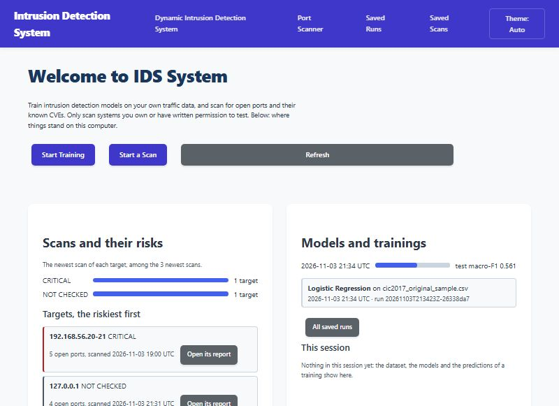

Click **Dynamic Intrusion Detection System** at the top. The trainer has six steps; the
buttons at the top (1. Data to 6. Use) move between the steps you have reached. Your
dataset and models stay in memory for this browser session only: a reload keeps them, a
restart of the trainer or **Clear workspace** removes them, and so does leaving the session
unused for 240 minutes.

### 4.1 Step 1: Data

Choose **No, I need to train a model**, then choose your file. You can pick one CSV/TXT
file, several parts of the same dataset, or an official train file plus its test file.
Here it is NSL-KDD: a sample of `KDDTrain+` and a sample of `KDDTest+`, whose name contains
"test".

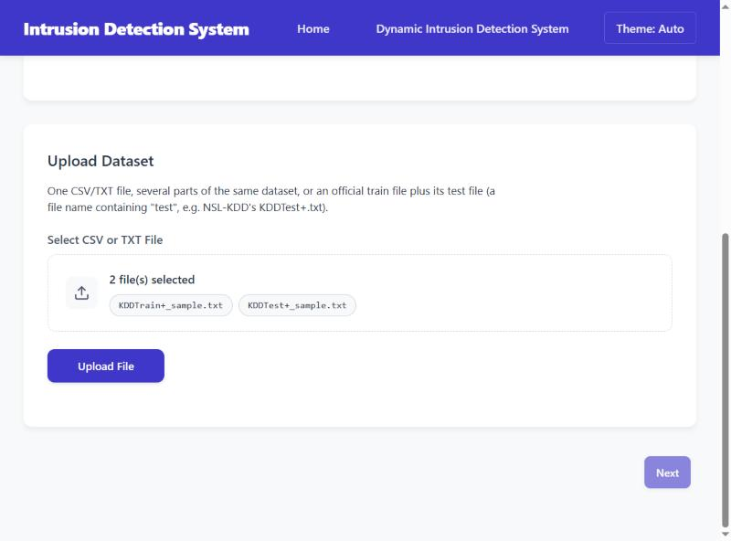

The box lists the chosen files (with more than six, the first five and how many more);
you can also drop files on it. After **Upload File** the trainer says what it recognised,
one fact per tile: the dataset (`nsl_kdd`), the label column (`attack`), the split
(`official`: the test file is the test split), the official test file and its rows, the
files read, the rows, the memory used, and the columns it will never use as features
(`level` is derived from the label; "None" when there are none). If a file can't be read,
the same place says **Upload failed** and why, and the last result is gone.

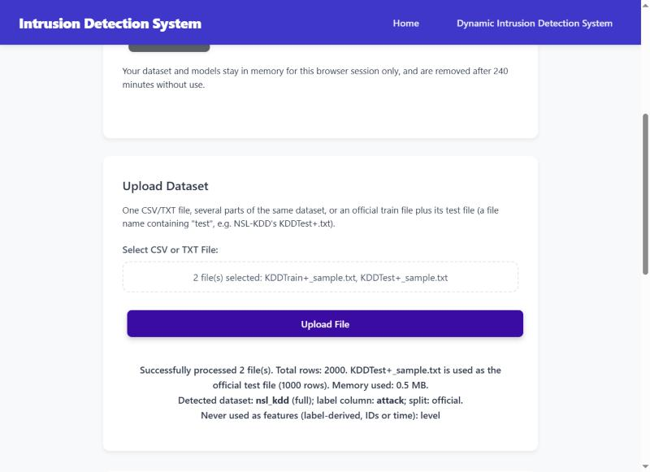

Below it, **Data Preview** shows the first rows and the column counts.

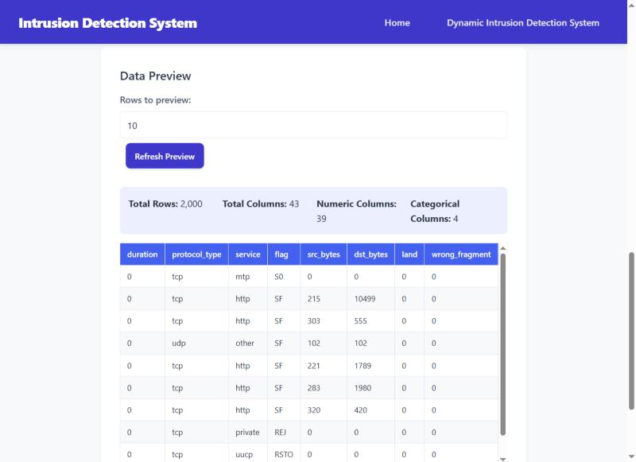

### 4.2 Step 2: Explore

**Next** goes to Explore. Choose the **target column** (the label), then **Analyze Class
Distribution**: how many rows each class has. The test split size only matters for a
dataset without an official test file.

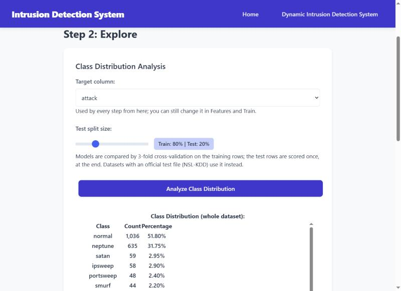

Below the table, the training-split analysis recommends a way to handle the imbalance
between classes. It is computed on the training rows only, so the test rows never
influence the choice. Here the smallest class has 2 rows, too few for SMOTE, so it
recommends class weights.

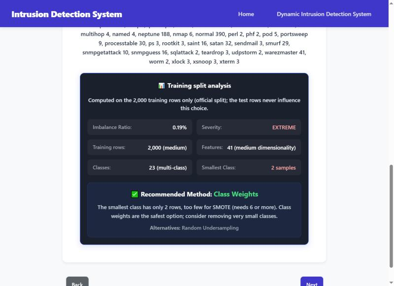

### 4.3 Step 3: Clean

**Filter Target Values** removes classes you don't want: tick them and click **Remove
Selected Values**. Here all classes are kept (**Skip**).

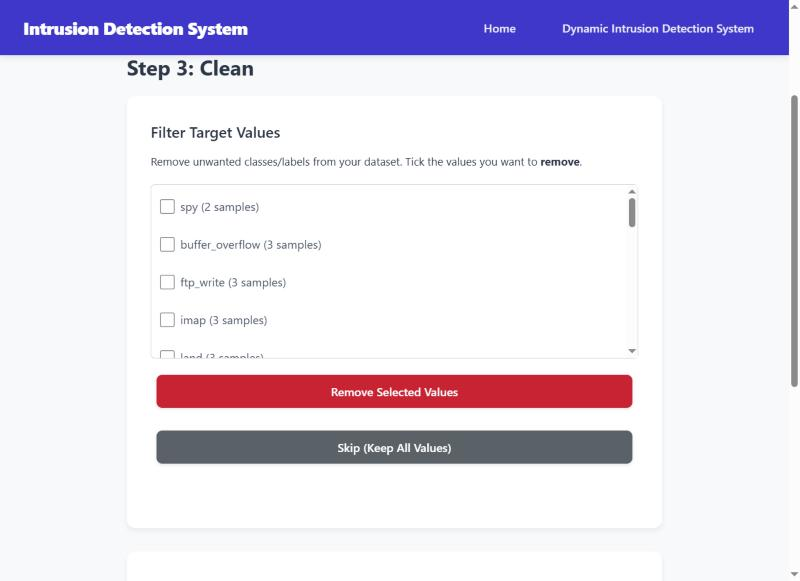

**Balancing** is set to the recommendation. **Preview on training split** shows the rows
per class before and after; class weights don't change the rows, they give the rare
classes more weight while training. The balancing is applied inside each model's training,
never to the test rows.

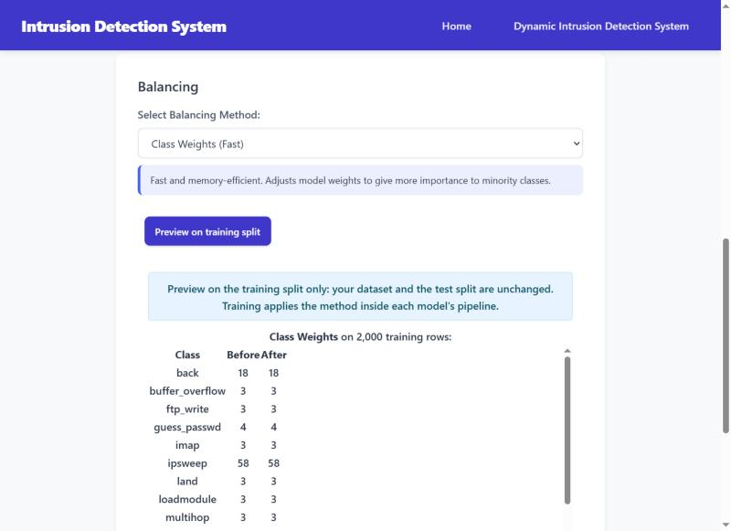

### 4.4 Step 4: Features

**Recommend Features** scores the columns on the training split and ticks the best `k`
(here 10). A score of `∞` means the column separates the classes perfectly on this split;
check that it isn't a copy of the label. The leakage guard has already left out columns
that must not be features (here `level`).

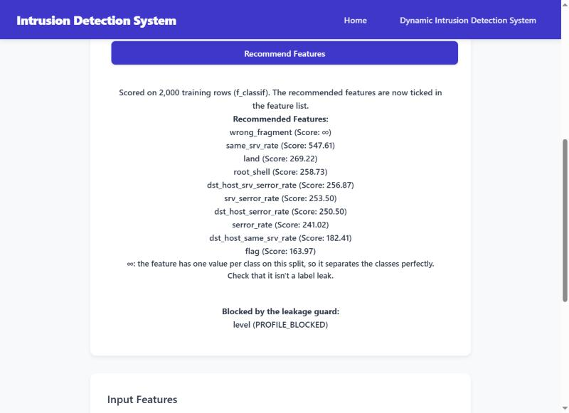

The **Input Features** list is what the models will use. Here **Select all** kept all 41
features. Even when `level` is ticked, the leakage guard leaves it out at training.

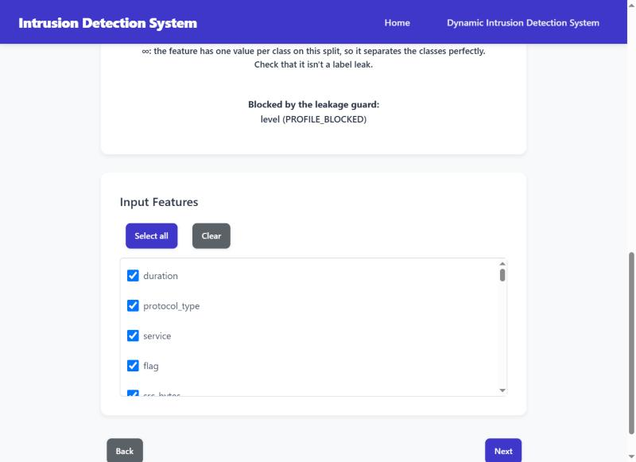

### 4.5 Step 5: Train

Check the target, tick the models and click **Train Model**. Training runs in the
background with a progress bar; **Cancel training** stops it, and nothing of a cancelled
run is kept.

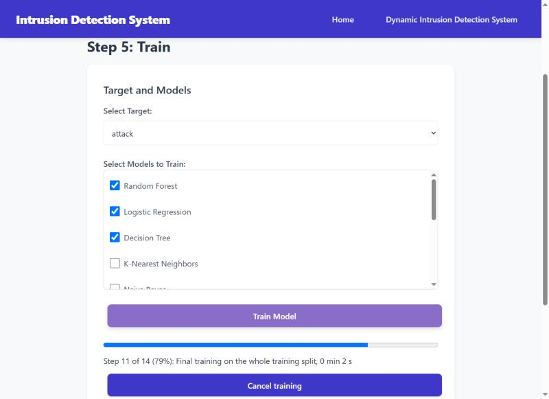

When it ends, the leaderboard compares the models:

- **CV macro-F1:** the score in 3-fold cross-validation on the training rows. The model with
  the best one is selected (★).
- **Test** columns: each model's score on the test split, which plays no part in training
  or in choosing the model.
- **Weakest class recall:** how well the model finds its hardest class.

The yellow notes matter. Here the NSL-KDD test file has 17 attack types that the training
file doesn't have, so no model can recognise them and the test scores are low
([datasets.md](datasets.md) explains the split).

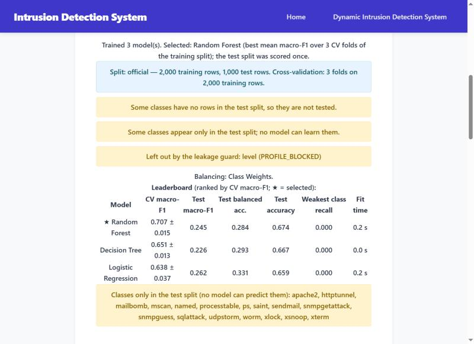

**Show Matrix** shows a model's confusion matrix on the test split: rows are the true
classes, columns the predicted ones, the diagonal is correct. A big matrix scrolls inside
its own box, and the class names stay in view.

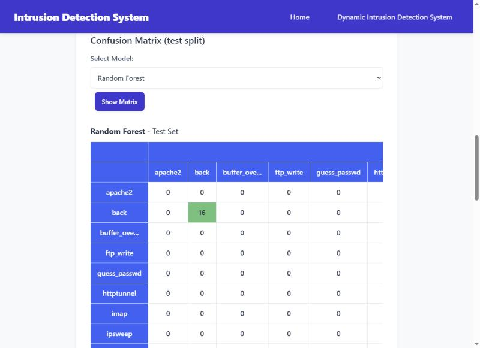

### 4.6 Step 6: Use

**Make a Prediction** takes one row: choose the model and fill in each feature under
**Enter one row by hand** (with more than 12 features it starts closed; for many rows,
**Predict a CSV File** is quicker). Here a
real `neptune` row from `KDDTest+`, predicted as `neptune`.

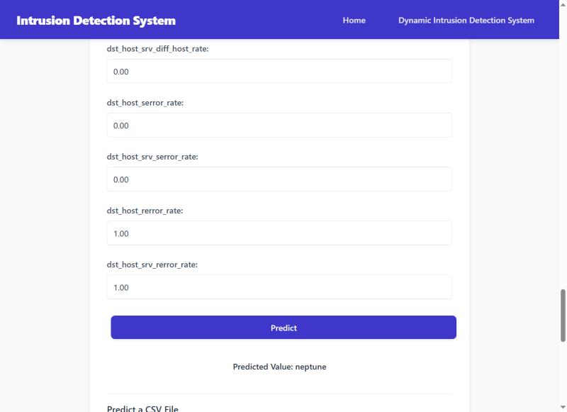

**Predict a CSV File** labels every row of a file that has the model's feature columns. If
the file also has the label column, the predictions are compared with it. Here 300 other
`KDDTest+` rows: 71.3% match. **Download** saves the file with a prediction per row.

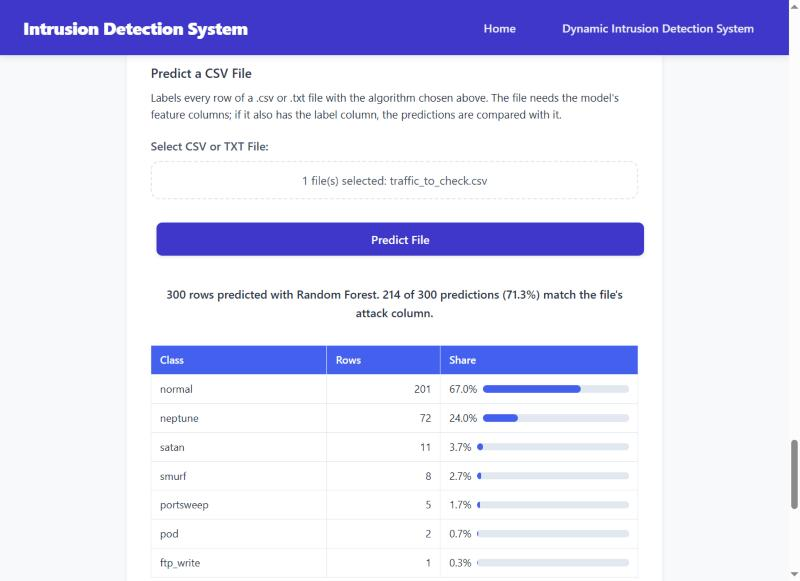

**Export Model** saves all models of the run as one signed `.bundle` file in
`instance\bundles\`, with the record of how they were trained. A bundle loads only on the
toolkit install that made it.

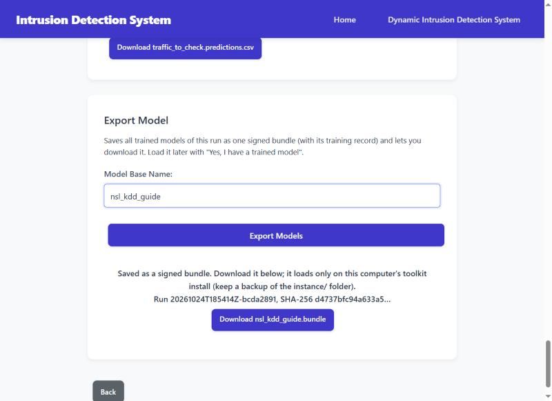

### 4.7 Load an export back

In Step 1 choose **Yes, I have a trained model**, then load the `.bundle` file. The page
shows its models and scores; Step 6 then predicts with them, one row or a file.

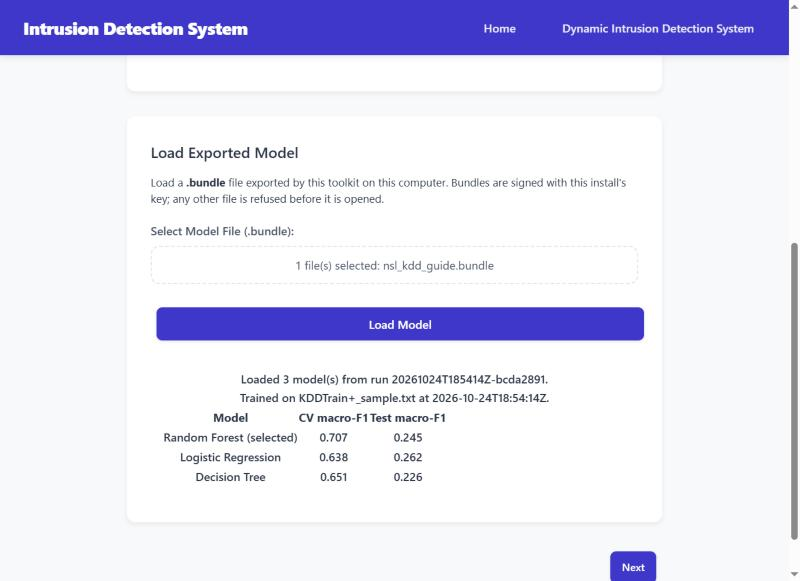

### 4.8 Compare saved runs

Each export also saves the run's record: its data, split, settings and scores, without the
models. **Saved Runs** in the navbar (or **See it in Saved Runs** after an export) lists
them, newest first, 50 at a time (**Older runs** shows more). Nothing is uploaded or trained
there, and no model is loaded.

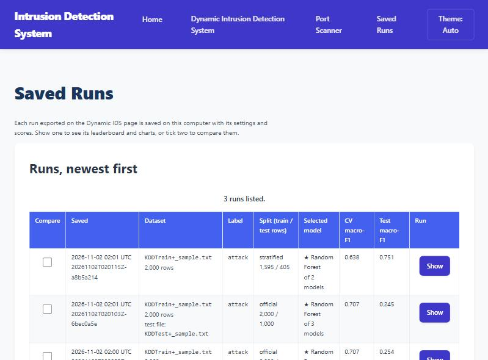

- **Show** opens one run: what it was trained on, its leaderboard and its charts.
- Tick two runs and click **Compare the two ticked runs**. A is the older one, B the newer.
  Each model of both runs gets a table with every score of A and B and, per class, the test
  recall.
- **Δ = B − A** is shown only when both runs scored the same test rows: the same file (and
  test file), the same label, the same split and the same row counts. Otherwise the numbers
  stand side by side and the page says why they can't be compared.
- Below: the models of one run only, and the settings that differ (features, models,
  balancing, feature selection).
- **Delete** removes a run, only when you ask. The page first lists every file it removes
  and its size, and asks: nothing is deleted before you click **Delete** there, and nothing
  is ever deleted on its own. The run's bundle (the large file) is kept unless you tick
  **Also delete its bundle**. If a file can't be removed (another program has it open), the
  run stays listed: close that program and delete it again.

Here the two runs of the same NSL-KDD files differ only in balancing, none (A) and class
weights (B): Random Forest's CV macro-F1 is the same, its test macro-F1 is 0.010 lower.

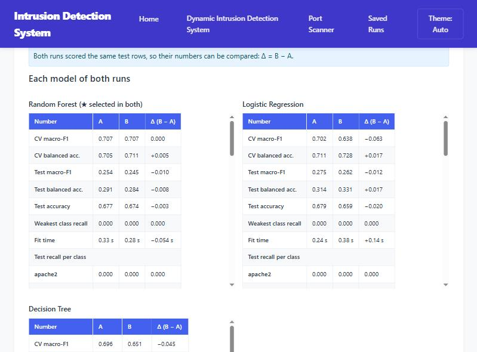

## 5. Use your model in the terminal

`python -m toolkit ids` uses the bundles you exported from the web trainer. These examples
use the export of section 4.

**List the exports** (newest first), without loading them:

```
> python -m toolkit ids --list
1. 20261024T185414Z-bcda2891  KDDTrain+_sample.txt  Random Forest +2  (0.9 MB)
```

**The model card** of the newest export (`--bundle` chooses another one):

```
> python -m toolkit ids --info
📦 Model bundle: run 20261024T185414Z-bcda2891 (exported on this install)
   Trained 2026-10-24T18:54:14Z on KDDTrain+_sample.txt (2,000 rows, SHA-256 3651ed8bd649…)
   Split: official, 2,000 train / 1,000 test rows
   ⚠️  some classes have no test rows
   ⚠️  some classes appear only in the test split
   Models (CV macro-F1 on the training split | test macro-F1 | test balanced accuracy):
   ⭐ Random Forest              0.707 ± 0.015 | 0.245 | 0.284
      Decision Tree              0.651 ± 0.013 | 0.226 | 0.293
      Logistic Regression        0.638 ± 0.037 | 0.262 | 0.331
   Classes (23): back, buffer_overflow, ftp_write, guess_passwd, imap, ipsweep, land, loadmodule, multihop, neptune, nmap, normal, perl, phf, pod, portsweep, rootkit, satan, smurf, spy, teardrop, warezclient, warezmaster
   Features: 41
```

**Interactively:** choose an export and a model, then predict. Option 2 takes a real row
from the model's test split. The list of 38 examples is shortened here:

```
> python -m toolkit ids
============================================================
🛡️  IDS with Machine Learning - CLI Tool
============================================================

📂 Models exported from the web trainer (newest first):
  1. 20261024T185414Z-bcda2891  KDDTrain+_sample.txt  Random Forest +2  (0.9 MB)

Choose an export (1-1, Enter = 1):
📦 Model bundle: run 20261024T185414Z-bcda2891 (exported on this install)
   Trained 2026-10-24T18:54:14Z on KDDTrain+_sample.txt (2,000 rows, SHA-256 3651ed8bd649…)
   Split: official, 2,000 train / 1,000 test rows
   ⚠️  some classes have no test rows
   ⚠️  some classes appear only in the test split
   Models (CV macro-F1 on the training split | test macro-F1 | test balanced accuracy):
   ⭐ Random Forest              0.707 ± 0.015 | 0.245 | 0.284
      Decision Tree              0.651 ± 0.013 | 0.226 | 0.293
      Logistic Regression        0.638 ± 0.037 | 0.262 | 0.331
   Classes (23): back, buffer_overflow, ftp_write, guess_passwd, imap, ipsweep, land, loadmodule, multihop, neptune, nmap, normal, perl, phf, pod, portsweep, rootkit, satan, smurf, spy, teardrop, warezclient, warezmaster
   Features: 41
  ⭐ 1. random_forest
     2. decision_tree
     3. logistic_regression

Enter model number (or press Enter for random_forest):
🎯 Ready for predictions with random_forest!

Options:
  1. Enter features manually
  2. Test with a real example (from the model's test split)
  3. Switch model
  4. Predict a CSV file
  5. Exit

Select option: 2
  1. apache2  (not learned: this class is only in the test split)
  2. back
  3. buffer_overflow
  ...
  14. named  (not learned: this class is only in the test split)
  15. neptune
  16. nmap
  17. normal
  ...

Choose example (1-38): 15
==================================================
🎯 PREDICTION RESULT
==================================================
   Status: 🚨 ATTACK DETECTED - neptune
   True label: neptune
   Confidence: 96.00%

   📊 Top Probabilities:
      neptune                   96.00% ███████████████████
      portsweep                  2.00%
      satan                      2.00%
      teardrop                   0.00%
      spy                        0.00%
==================================================

Options:
  1. Enter features manually
  2. Test with a real example (from the model's test split)
  3. Switch model
  4. Predict a CSV file
  5. Exit

Select option: 5
👋 Goodbye!
```

**A whole file:** `--csv` labels every row and writes `<file>.predictions.csv` next to it
(never over an existing file; `--output` chooses the name). When the file has the label
column, the predictions are compared with it.

```
> python -m toolkit ids --csv traffic_to_check.csv
✅ 300 rows predicted with random_forest; saved to traffic_to_check.predictions.csv
   normal                              201
   neptune                              72
   satan                                11
   smurf                                 8
   portsweep                             5
   pod                                   2
   ftp_write                             1
   214 of 300 predictions (71.3%) match the file's attack column
```

**From a script:** `--json` takes rows as JSON (an object or a list, inline or in a
`.json` file) and prints the results as JSON. Here two `KDDTest+` rows whose real labels
are `guess_passwd` and `smurf`: the first is predicted wrongly, as `normal`.

```
> python -m toolkit ids --json rows.json
[
 {
  "prediction": "normal",
  "model": "random_forest",
  "confidence": 0.93,
  "top": [
   [
    "normal",
    0.93
   ],
   [
    "warezmaster",
    0.04
   ],
   [
    "teardrop",
    0.01
   ],
   [
    "phf",
    0.01
   ],
   [
    "satan",
    0.01
   ]
  ]
 },
 {
  "prediction": "smurf",
  "model": "random_forest",
  "confidence": 0.89,
  "top": [
   [
    "smurf",
    0.89
   ],
   [
    "normal",
    0.11
   ],
   [
    "warezclient",
    0.0
   ],
   [
    "teardrop",
    0.0
   ],
   [
    "spy",
    0.0
   ]
  ]
 }
]
```

`--model` chooses a model of the bundle (default: its best). The exit codes, for scripts,
are in [reference.md, section 6](reference.md#6-exit-codes).

**The saved runs** (section 4.8) are in the terminal too, without loading a model. The list,
newest first (50 at a time; its last line gives the `--before` for the older ones):

```
> python -m toolkit ids --runs
1. 20261102T020115Z-a8b5a214  2026-11-02 02:01 UTC  KDDTrain+_sample.txt (2,000 rows)  label attack, stratified 1,595/405  ★ Random Forest of 2: CV 0.638, test 0.751
2. 20261102T020103Z-6bec0a5e  2026-11-02 02:01 UTC  KDDTrain+_sample.txt (2,000 rows), test file KDDTest+_sample.txt  label attack, official 2,000/1,000  ★ Random Forest of 3: CV 0.707, test 0.245
3. 20261102T020053Z-8c45b90b  2026-11-02 02:00 UTC  KDDTrain+_sample.txt (2,000 rows), test file KDDTest+_sample.txt  label attack, official 2,000/1,000  ★ Random Forest of 3: CV 0.707, test 0.254
```

`--delete RUN_ID` deletes one, as the page's **Delete** does: it lists the files and asks
`[y/N]` first, and keeps the bundle unless you add `--with-bundle`.

`--compare A B` prints the two side by side, as the page does. The 23 classes and the other
two models are shortened here:

```
> python -m toolkit ids --compare 20261102T020053Z-8c45b90b 20261102T020103Z-6bec0a5e
A: 20261102T020053Z-8c45b90b  2026-11-02 02:00 UTC  KDDTrain+_sample.txt (2,000 rows), test file KDDTest+_sample.txt  label attack, official 2,000/1,000  ★ Random Forest of 3: CV 0.707, test 0.254
B: 20261102T020103Z-6bec0a5e  2026-11-02 02:01 UTC  KDDTrain+_sample.txt (2,000 rows), test file KDDTest+_sample.txt  label attack, official 2,000/1,000  ★ Random Forest of 3: CV 0.707, test 0.245

✅ Both runs scored the same test rows, so their numbers can be compared: Δ = B − A.

Random Forest (★ selected in both)
                                       A         B   Δ (B − A)
  CV macro-F1                      0.707     0.707       0.000
  CV balanced acc.                 0.705     0.711      +0.005
  Test macro-F1                    0.254     0.245      −0.010
  Test balanced acc.               0.291     0.284      −0.008
  Test accuracy                    0.677     0.674      −0.003
  Weakest class recall             0.000     0.000       0.000
  Fit time                        0.33 s    0.28 s    −0.054 s
  Test recall per class
    apache2                        0.000     0.000       0.000
    back                           0.941     0.941       0.000
    buffer_overflow                0.250     0.000      −0.250
...

Settings that differ:
  Balancing
    A: none
    B: class_weight
```

With the run of the training file alone (a stratified split) as B, there is no Δ, and why:

```
⚠️ These runs did not score the same test rows, so the numbers are side by side, without a difference:
   - Their test rows came from different test files, or only one had a test file.
   - Their splits differ (the strategy, the seed, the test size or the official mode).
   - They had different numbers of training or test rows.
```

## 6. Your files

Everything the toolkit keeps is in the `instance` folder of the project folder
(`python -m toolkit --help` prints where it is):

| Path | What |
|---|---|
| `instance\bundles\` | your exports, one `.bundle` file each |
| `instance\runs\` | the record of each exported run: data, split, settings, scores |
| `instance\scans\` | exported scan reports |
| `instance\logs\` | one log file per tool (`web.log`, `scanner.log`, `ids_cli.log`) |
| `instance\uploads\` | temporary copies of the datasets uploaded to the web trainer |
| `instance\signing.key` | the key that signs your exports |

An installed copy (`pip install .`) keeps these in a per-user folder instead
([reference.md, section 7.3](reference.md#73-where-the-data-folder-is)). Your API keys are
in `.env` in the project folder.

### 6.1 Who can open them

The toolkit trusts this computer: whoever is signed in to it as you, and whoever you give
the web app's access token to (section 3.7), has the same rights over these files. Other
accounts on the computer are kept out by the operating system's permissions only, so each
tool (a scan, the IDS, the web trainer) sets them when it starts: `instance` and `.env` can be opened by your account, SYSTEM
(which Windows needs for backups and services) and the Administrators only, and nothing is
inherited from the folder above (on Windows a second drive such as `D:` often gives
everyone full control). Every file made in `instance`, the signing key too, gets the same.
On Linux and macOS the folder is `700` and `.env` `600`.

When they can't be set, for example on a USB drive formatted FAT, which has no permissions,
the tool says so as it starts and goes on:

```
Could not limit who may open E:\toolkit\instance (...): other accounts on this computer may be able to read it.
```

The signature of a bundle proves it was made with this install's key and not changed
since. It hides nothing: whoever can read a bundle can read the model, its settings and its
example rows. Whoever has a copy of `signing.key` can make bundles this install loads and
open the ones it made, so keep its backups where only you can read them.

### 6.2 Back up and restore

Back up these three, together:

| Path | Why |
|---|---|
| `instance\signing.key` | without it, no bundle made here loads again (a new key doesn't bring them back) |
| `instance\bundles\` | your exports |
| `instance\runs\` | the record of each run, to retrain from if a bundle is lost, and the importance results saved beside it |

The logs and the uploads need no backup, and the scan reports only if you want to keep them.

To restore, on this computer or on a new install: start the web trainer once
(`python -m toolkit web`, then stop it with Ctrl+C: it makes the `instance` folder and
protects it), then copy the three into it. Copy them rather than move
them, so they get the folder's permissions (a file moved on the same drive keeps its old
ones). Do it before your first export on a new install: an export makes a new key, and the
bundles saved with that key won't load once your old key is back.

## 7. If something goes wrong

| What you see | What to do |
|---|---|
| `INTERRUPTED: a training asked for at ... was cut off ...` (in the terminal as the trainer starts, and once on its page) | The last trainer stopped while that job ran or waited: its workspace is gone with it. Upload the dataset again and start the training again (for a scan: start it again) |
| `Another toolkit web server is already using the data folder ...` | The trainer is already running (the message says its process and address): open that one, or stop it with Ctrl+C in its window. A second one needs a folder of its own: `TOOLKIT_INSTANCE_DIR` |
| `Port 5000 is already in use on this computer: ...` | The trainer may already be running: open the printed address. Or start it on another port: `python -m toolkit web --port 5001` |
| `TOOLKIT_... must be ...` and the command stops | A setting has a wrong value: fix it or remove it ([reference.md, section 7.1](reference.md#71-toolkit_-settings)) |
| `No exported model yet: train one in the web trainer and click Export ...` | Train and export a model first (section 4), or give a bundle with `--bundle` |
| `[INCOMPLETE: the export was interrupted; ...]` after an export in `--list`, or `An incomplete bundle of this run is in the bundles folder ...` on Export | Part of a bundle is under its name: an export cut off by an older version of the toolkit, or a copy that stopped (the toolkit never removes it on its own). Delete that `<run id>.bundle` from `instance/bundles`, then export again |
| `The bundle's signature does not match this install's signing key: ...` | The bundle was made by another install or changed after it was saved; only bundles made here load |
| `Host 127.0.0.1 did not respond to ping.` | The host may block ping: add `--scan-unresponsive` to scan it anyway |
| `Lookup failed: NVD: timed out` | NVD didn't answer in time; scan again later or set an `NVD_API_KEY` |
| `Upload too large (limit: 2048 MB).` | Raise `TOOLKIT_MAX_UPLOAD_MB` before starting the trainer, or upload a smaller file |

More in the README's troubleshooting section ([README.md](../README.md)) and in
[reference.md](reference.md).

## The data in this guide

The pictures and outputs use real rows of NSL-KDD, a stratified sample made with a fixed
seed: 2,000 rows of `KDDTrain+` (all 23 classes), 1,000 rows of `KDDTest+`, and 300 other
`KDDTest+` rows for the file predictions. Its terms allow redistribution and require this
citation:

- **NSL-KDD:** the NSL-KDD dataset, and M. Tavallaee, E. Bagheri, W. Lu, A. A. Ghorbani,
  "A Detailed Analysis of the KDD CUP 99 Data Set", IEEE CISDA 2009.
  https://www.unb.ca/cic/datasets/nsl.html
